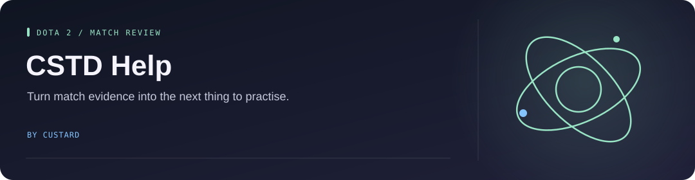

<!-- Project artwork created for this repository. -->
<p align="center">
  
</p>

<h1 align="center">CSTD Help</h1>

<p align="center">
  
</p>

**A personal match-review workbench that turns match data into practical next-game actions.**

<p align="center"><a href="#how-it-works">How it works</a> &nbsp; · &nbsp; <a href="#run-locally">Run locally</a> &nbsp; · &nbsp; <a href="#code-and-checks">Code and checks</a></p>

[Analysis engine](docs/ANALYSIS_ENGINE.md) · [Known limitations](docs/KNOWN_LIMITATIONS.md) · [Deployment status](docs/DEPLOYMENT_STATUS.md)

**Status:** the hosted service is offline. Local development and CI remain available; Cloudflare deployment and remote cache jobs are disabled by default.

## How it works

1. Read the cached latest ten matches for the configured player.
2. Click refresh to fetch new matches, or request a review for one match.
3. Collect evidence and apply versioned scoring formulas.

Reviews use deterministic rules, not an LLM. Missing required evidence blocks a new review rather than being filled with invented values. Historical static reports remain in the repository separately.

## Run locally

Use Python **3.13**, Node.js, and `uv`. The supplied worker launcher uses PowerShell.

```powershell
python -m uv sync --locked --python 3.13 --group cli
python scripts/build_workbench_site.py
powershell -ExecutionPolicy Bypass -File scripts/run_worker_dev.ps1
```

In another terminal:

```powershell
python scripts/run_workbench_dev.py --port 8808 --api-origin http://127.0.0.1:8791
```

Open `http://127.0.0.1:8808`. Live refresh and review jobs also require the configured KV namespace, workflow dispatch token, and upstream credentials; see [setup and deployment](docs/MAINTENANCE.md).

## Code and checks

- `analysis/` — evidence rules and scoring.
- `api/` — upstream data clients.
- `public/` — the web interface and historical reports.

```bash
python -m uv run --no-sync python -m unittest discover -s tests -p "test*.py"
```

The workflow is configured for a fixed player account, not a general public review service.
